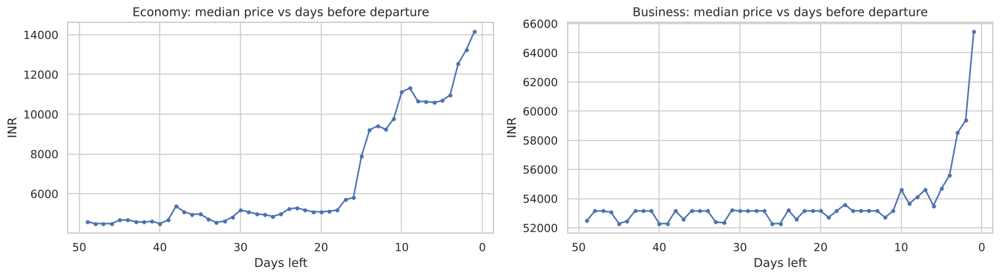
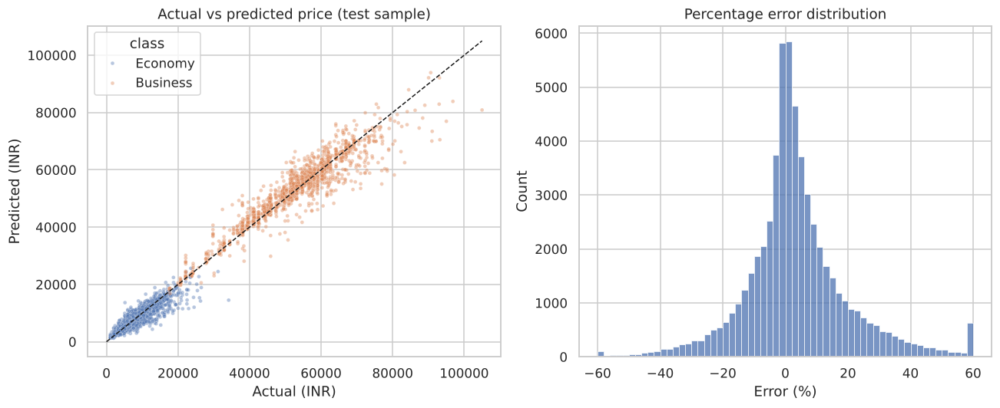

# Flight Price Prediction

**What drives the price of a flight ticket, and when should you book?**

A gradient boosting model that predicts domestic flight prices with **R² 0.985 and about 12% average error** on 60,000 unseen flights, plus a Streamlit app that estimates a fare and shows the cheapest day to book.

**Live app:** [irsyad-flight-price.streamlit.app](https://irsyad-flight-price.streamlit.app/)



## Key findings

* **Book early.** Economy fares are flat for weeks, then jump about two weeks before departure. Booking 22–49 days ahead is **65% cheaper** than booking 1–2 days ahead (median ₹4,819 vs ₹13,673).
* **Class splits the market.** The median Business ticket costs about **9× the median Economy ticket** (₹53,164 vs ₹5,780).
* **Stops are not a discount.** One-stop flights are typically priced above non-stop flights, because they serve longer routes.
* **What the model relies on, in order of importance:** class, then duration, route, airline and days left.

## Model comparison (test set, 59,588 flights)

| Model | MAE (₹) | RMSE (₹) | R² | MAPE |
| --- | --- | --- | --- | --- |
| **Histogram gradient boosting** ✔ | 1,493 | **2,760** | **0.985** | 11.8% |
| Decision tree | **1,194** | 2,918 | 0.983 | **8.2%** |
| Random forest (60k sample) | 1,436 | 3,020 | 0.982 | 10.2% |
| Ridge regression (baseline) | 4,576 | 6,734 | 0.912 | 47.3% |

Gradient boosting was chosen for the lowest RMSE (fewest large misses) and the smallest train-test gap. The decision tree is more accurate on typical cheap tickets but makes more large errors.
By class, the error is 5.0% for Business and 14.9% for Economy.



## Approach

1. **Data quality:** 300,153 rows, no missing values. Dropped the row index and flight code, and removed 2,213 duplicates.
2. **Feature engineering:** added `route` (source → destination), because price depends on the city pair.
3. **EDA:** price by class, airline, stops and booking window.
4. **Modelling:** compared four models with an 80/20 split, using a ColumnTransformer and scikit-learn pipelines.
5. **Evaluation:** MAE, RMSE, R² and MAPE, error by class, and permutation importance.
6. **Deployment:** the saved pipeline powers a Streamlit app (`app/app.py`).

## Project structure

```
├── flight_price_prediction.ipynb   # full analysis
├── build_notebook.py / nbrun.py    # rebuild and re-execute the notebook
├── app/app.py                      # Streamlit app (+ saved model and metadata)
├── data/airlines_flights_data.csv.gz
└── images/
```

**Run locally:** `pip install -r requirements.txt` then `streamlit run app/app.py`.

## Team and my role

Final Project of the Digital Skola Data Science Bootcamp (2026), team Yggdrasil (Kel 2). I worked on data cleaning and EDA, feature engineering, modelling and evaluation, and the final presentation.
The team's submitted version used a tuned XGBoost (test R² 0.98, MAE ₹1,707, MAPE 12.3% on a 60,000-row sample). This repository is my own rebuild on the full dataset with scikit-learn only.

Data: *Airlines Flights Data* (public dataset of flights between six major Indian cities).

---
Muhammad Irsyad Dzulfaqor · [LinkedIn](https://www.linkedin.com/in/mirsyaddzulfaqor/) · [GitHub](https://github.com/mirsyaddzulfaqor-tech)
